# Employee Attrition Prediction and Risk Scoring

**Author:** Dev Rishi Mishra  
**Contact:** devrishi610@gmail.com

This project studies employee attrition using data analysis and machine learning. It explores patterns in the employee dataset, trains classification models, estimates attrition probabilities, and presents the results through an interactive Streamlit dashboard.

The project was completed as a learning and decision-support prototype. Its predictions should be reviewed with care and must not be used as the only basis for decisions about an employee.

## Project at a glance

- **Dataset:** 1,470 employee records and 31 original columns
- **Observed attrition:** 237 employees (16.12%) left; 1,233 (83.88%) stayed
- **Target:** `Attrition` (`0` = stayed, `1` = left)
- **Final model:** Logistic Regression with a 0.50 classification threshold
- **Dashboard:** Streamlit, with five interactive sections

## 1. Dataset checks and exploratory analysis

The notebook checks the dataset shape, columns, data types, missing values, duplicate records, and target balance. No missing values or duplicate records were found in the supplied dataset.

The exploratory data analysis (EDA) looks at attrition across departments, job roles, overtime and job satisfaction. It also compares age, monthly income, work experience and company tenure, and reviews correlations between numerical fields. A separate analysis looks more closely at Sales Representatives because this job role had the highest attrition rate in the notebook analysis.

### Notebook charts

The following figures are exported from the project notebook and included in the `assets/` folder.

| Figure | What it shows |
|---|---|
| 01 | Overall attrition distribution |
| 02 | Attrition by department |
| 03 | Attrition by job role |
| 04 | Attrition by overtime |
| 05 | Attrition by job satisfaction |
| 06 | Age comparison |
| 07 | Monthly income comparison |
| 08 | Correlation heatmap |
| 09 | Confusion matrices for final models |
| 10 | Precision-recall comparison |
| 11 | SHAP summary plot |
| 12 | SHAP feature importance |
| 13 | Individual SHAP explanation |
| 14 | Risk category distribution in the test set |
| 15 | Actual attrition rate across risk categories |

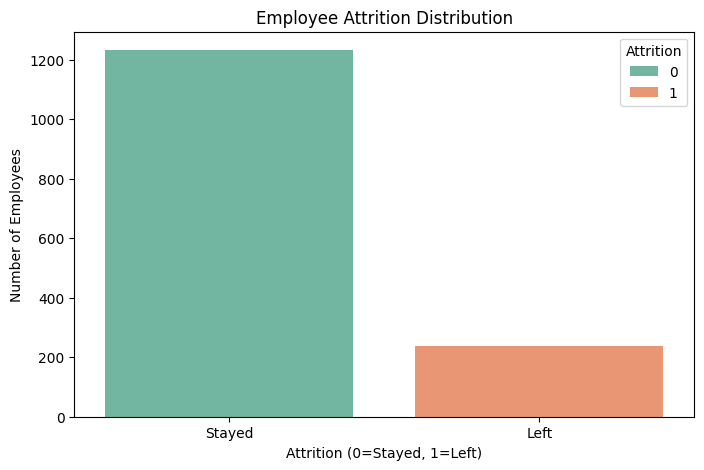
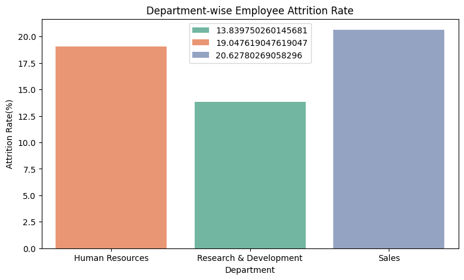
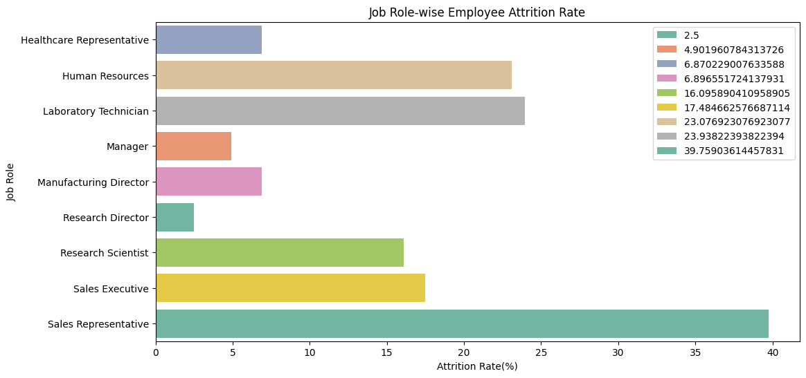
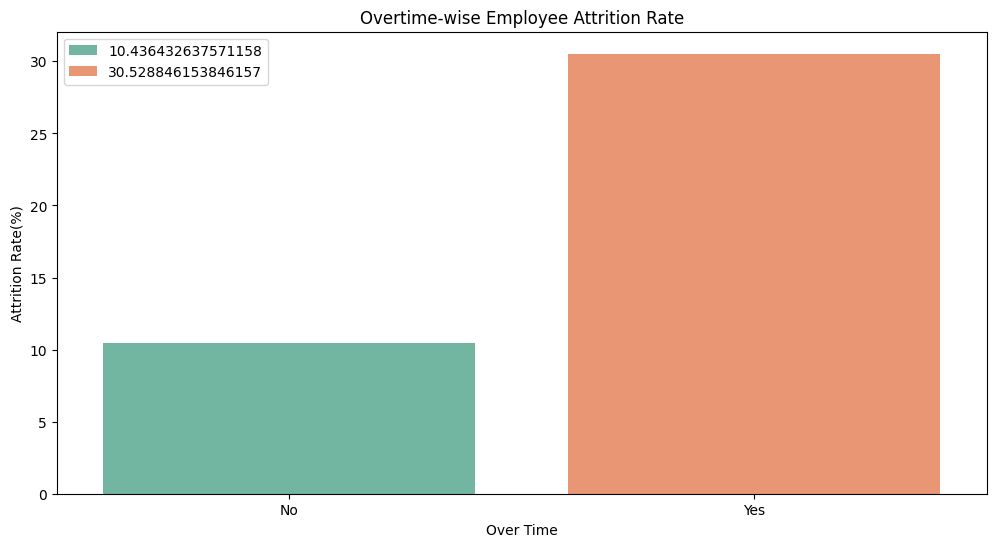
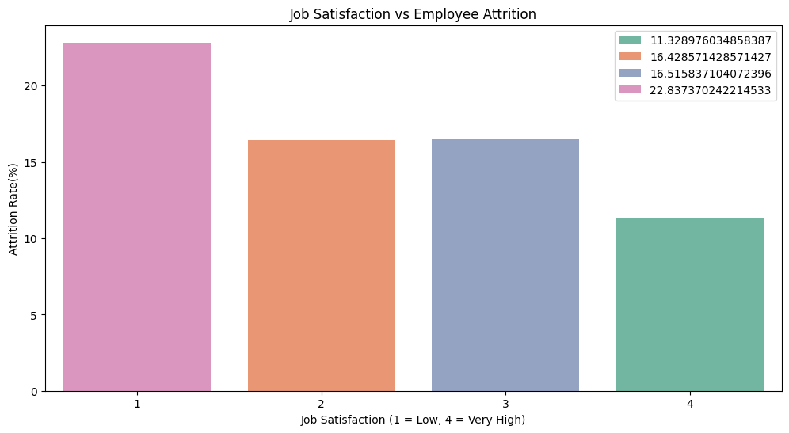
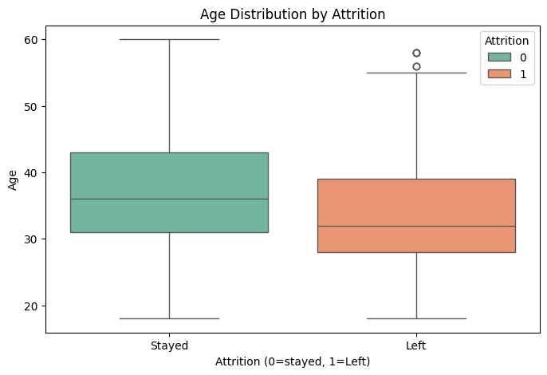
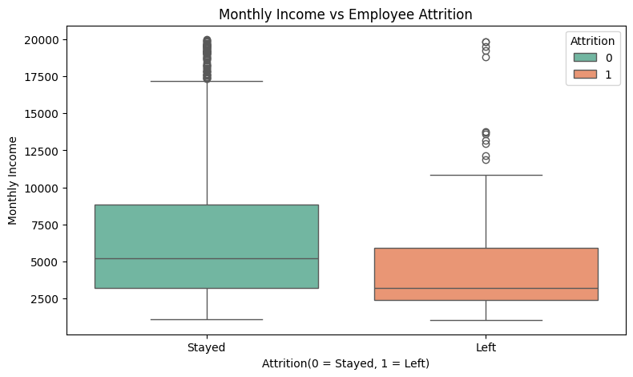
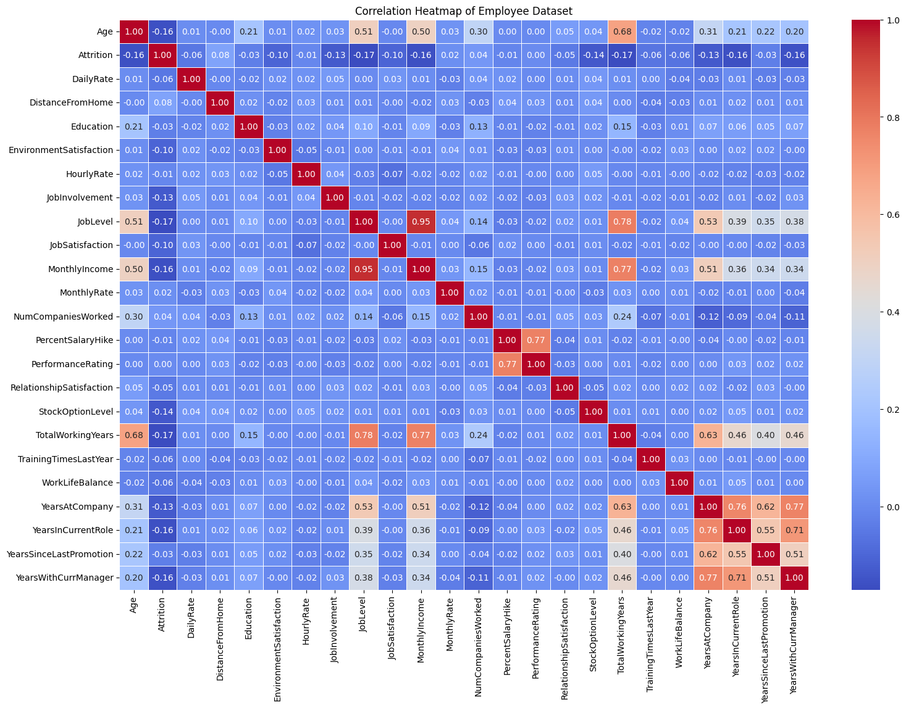
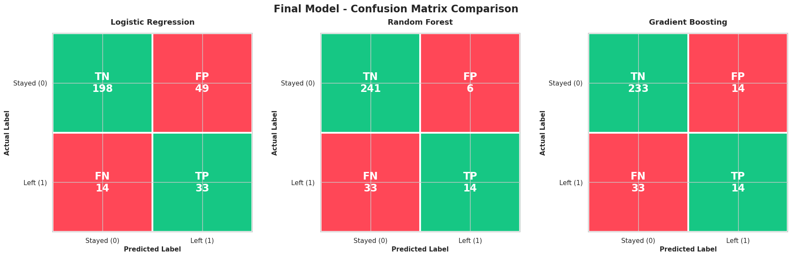
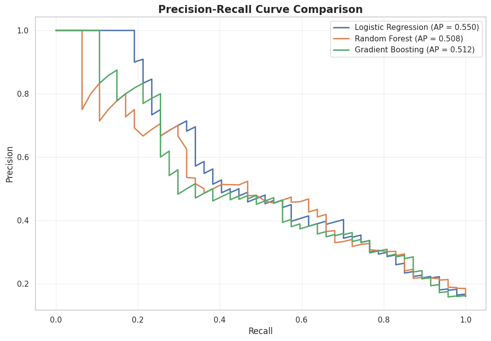
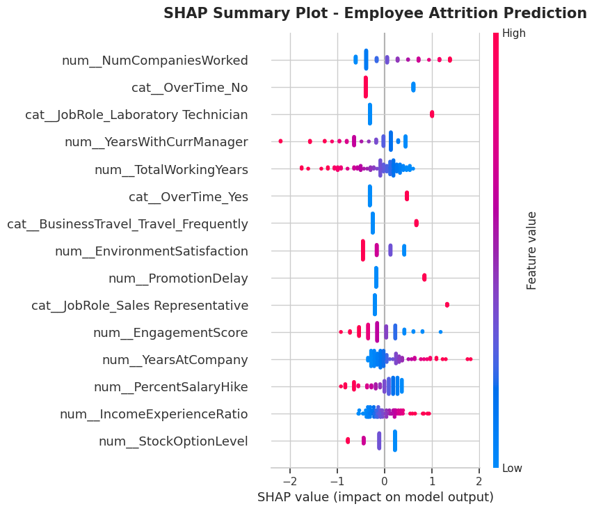
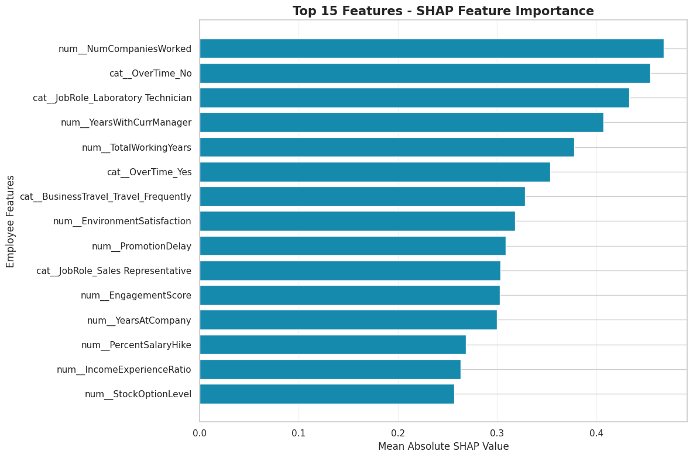
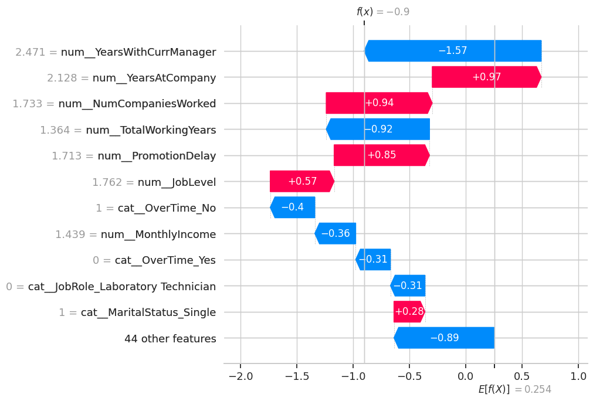
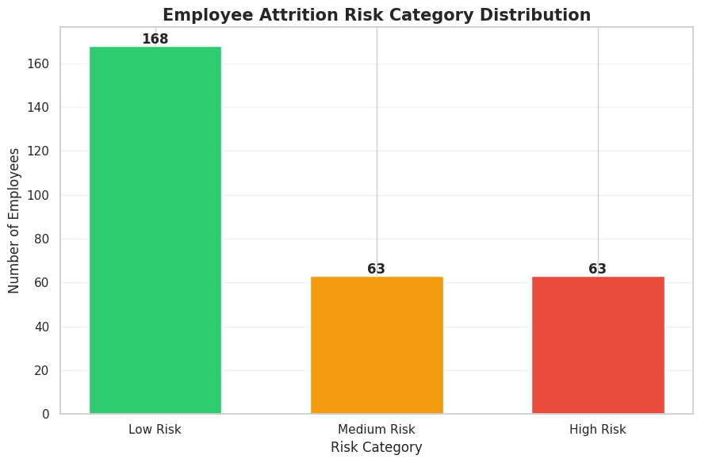
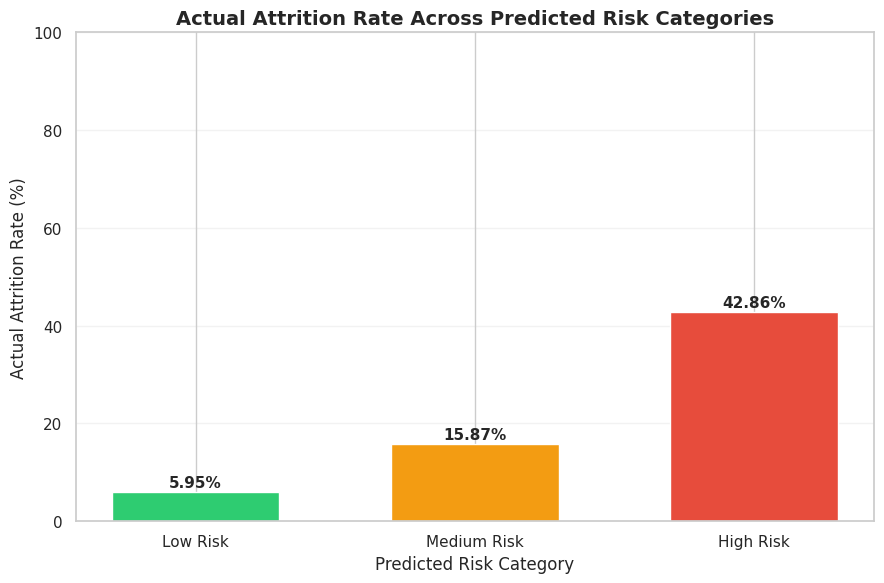

## 2. Feature engineering

Four features were added to represent combinations of existing employee fields:

- **IncomeExperienceRatio:** monthly income divided by total working years plus one.
- **PromotionDelay:** a flag for employees with at least three years since their last promotion.
- **EngagementScore:** the average of job involvement, job satisfaction, environment satisfaction, relationship satisfaction and work-life balance.
- **WorkloadStress:** a flag for employees who work overtime and have a work-life balance score of 2 or below.

These are project-defined features. They are not clinical or psychological measures.

## 3. Data preparation and model training

The notebook uses a stratified 80:20 train-test split so that the attrition class share is kept similar in both sets. Categorical fields are one-hot encoded, numerical fields are scaled, and SMOTE is applied to the training data only to address class imbalance.

Three final classifiers are compared:

- Logistic Regression
- Random Forest
- Gradient Boosting

### Final test-set model results

| Model / threshold | Accuracy | Precision | Recall | F1 score | ROC-AUC |
|---|---:|---:|---:|---:|---:|
| Logistic Regression (0.50) | 78.57% | 40.24% | 70.21% | **51.16%** | 0.797 |
| Logistic Regression (0.764) | 84.35% | 51.16% | 46.81% | 48.89% | 0.796 |
| Random Forest (0.50) | 86.74% | 70.00% | 29.79% | 41.79% | 0.803 |
| Gradient Boosting (0.50) | 84.01% | 50.00% | 29.79% | 37.33% | 0.787 |

Logistic Regression at 0.50 was selected because it achieved the highest F1 score among the compared final models and the strongest recall. The threshold-tuned Logistic Regression result is shown for comparison; it was not selected because its F1 score and recall were lower.

## 4. Model explainability

The notebook reviews Logistic Regression coefficients and includes SHAP analysis on a sample of test records, including an individual example. SHAP is used in the notebook to study how features contribute to model outputs.

The dashboard's individual explanation is based on Logistic Regression coefficients and feature values. It is **not** a SHAP explanation. These methods describe patterns learned by the model; they do not prove that a feature causes an employee to leave.

## 5. Risk scoring

The model estimates an attrition probability between 0 and 1. The project groups probabilities into these bands:

- **Low Risk:** below 30%
- **Medium Risk:** 30% to 60%, inclusive
- **High Risk:** above 60%

On the notebook's 294-record held-out test set, the risk groups were:

| Risk group | Employees | Share | Actual attrition rate |
|---|---:|---:|---:|
| Low Risk | 168 | 57.14% | 5.95% |
| Medium Risk | 63 | 21.43% | 15.87% |
| High Risk | 63 | 21.43% | 42.86% |

The dashboard scores all 1,470 supplied rows. Its full-dataset risk counts are 804 Low Risk, 334 Medium Risk and 332 High Risk. The actual attrition rates within these dashboard groups are 3.48%, 13.47% and 49.40%, respectively. These full-dataset dashboard figures are different from the notebook test-set figures because they describe different groups of records.

## 6. Streamlit dashboard

The `app.py` file contains five sections:

1. **Executive Overview** — employee count, observed attrition rate, predicted high-risk count, predicted attrition at the selected threshold, risk distribution and high-risk records.
2. **Employee Risk Profile** — an individual record's estimated probability, risk band, model outcome and selected profile details.
3. **Department Analytics** — risk summaries by department and job role.
4. **AI Explainability** — overall Logistic Regression coefficient information and an individual coefficient-based feature contribution view.
5. **What-if Simulator** — lets a user change selected profile fields and see how the model estimate changes in that scenario.

The dashboard includes department, job-role and risk filters, a threshold slider, colourful charts, a warm light theme and cartoon illustrations. The risk-category face illustration is only a visual indicator for the model's risk band. It does not describe an employee's actual emotions or state of mind.

The dashboard displays generated labels such as `EMP0001`, `EMP0002` and so on because the supplied dataset does not contain an original employee ID field. These labels are row-based references only.

## 7. Project files

- `app.py` — Streamlit dashboard
- `employee_data.csv` — supplied employee dataset
- `employee_attrition_model_bundle_vscode.joblib` — fitted model and preprocessing bundle
- `ML_Employee_Attrition_Prediction_VSCode_Compatible.ipynb` — project notebook
- `rebuild_model_vscode.py` — local model-bundle rebuild script
- `check_project.py` — basic project and model-bundle check
- `assets/` — 15 exported notebook figures
- `Employee_Attrition_Executive_Summary.pdf` — short project summary
- `Employee_Attrition_Research_Paper_Dev_Rishi_Mishra.pdf` — detailed research paper
- `Project_Requirements.pdf` — project brief supplied for this work

## 8. Run the dashboard

1. Install Python and open a terminal in the project folder.
2. Install the required packages if they are not already installed: `streamlit`, `pandas`, `numpy`, `scikit-learn`, `joblib` and `plotly`.
3. Run:

```bash
streamlit run app.py
```

Keep `app.py`, `employee_data.csv` and `employee_attrition_model_bundle_vscode.joblib` in the same folder.

## 9. Limitations and responsible use

- The dataset represents a historical case study. Model performance may change on new data.
- The risk bands are thresholds chosen for this project; they are not validated HR standards.
- A predicted probability is an estimate, not a certainty.
- Feature contributions and SHAP values show model behaviour, not cause and effect.
- The generated employee labels are not real employee identifiers.
- The dashboard is a learning and decision-support prototype. Any real-world use would require suitable data checks, privacy safeguards, fairness testing, validation on current data and meaningful human review.

## Author

**Dev Rishi Mishra**  
**Email:** devrishi610@gmail.com
